<h1 align="center"> Documentos OCR + IA 📝🤖<br>
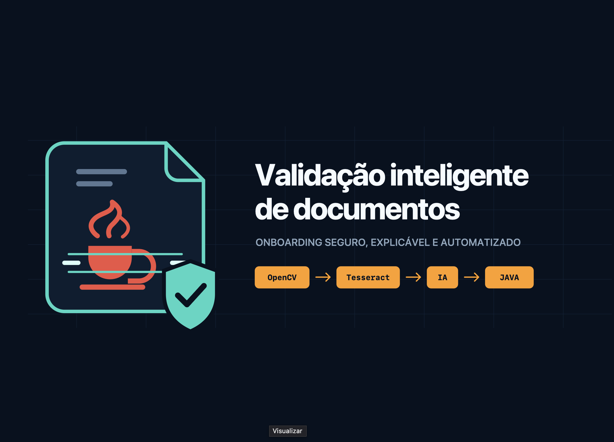 <br>


[](https://github.com/wqiluc/Documentos-ocr-ia-java/blob/main/LICENSE)


</h1>

<p align="center">
Validação inteligente de documentos no <b>cadastro de novos clientes (onboarding) de um banco digital</b> —
o cliente envia o documento de identificação (RG/CNH) e o comprovante de residência, e o sistema faz
<b>OpenCV → Tesseract (OCR) → IA → regras em Java</b> para aprovar ou reprovar o cadastro, sempre
informando o motivo.
</p>

> 🚧 **Status:** MVP do comprovante de residência implementado (backend Spring Boot + frontend React). A API sobe com
> **H2 em memória** por padrão; PostgreSQL é opcional. Coleção do Postman/Insomnia em [`postman/`](postman/) e contrato
> OpenAPI em [`docs/openapi.yaml`](docs/openapi.yaml).


<h2 align="center" id="docente">👨‍🏫 Docente: </h2>
<ul>
<li><b>Kleber Meira</b> <a href="https://www.linkedin.com/in/kleber-m-3b5532b6/" target="_blank"></a> <a href="https://github.com/KleberMeira" target="_blank"></a></li>
</ul>

<h2 align="center" id="autor">👤👨‍🎓 Autor: </h2>
<ul>
<li><b>Lucas Paguetti Pereira</b> <a href="https://www.linkedin.com/in/lucas-paguetti-pereira" target="_blank"></a> <a href="https://github.com/wqiluc" target="_blank"></a></li>
</ul>


<h2 align="center" id="tecnologias"> ⛏️💻 Tecnologias Utilizadas: <br>

</h2>
<p align="center">
   <br>
  
  
  
  
   <br>
  
  
  
   <br>
  
  
  
  
   <br>
  
  
  
  
   <br>
  
   <br>
  
  
  
</p>

<details>
<summary>▶️📦 <b>Versões e papel de cada tecnologia</b></summary>

| Tecnologia | Versão | Papel |
| :--- | :---: | :--- |
|  | 21 | Linguagem do backend |
|  | 3.5.16 | API REST, JPA e validação |
|  | 3.9+ | Build e dependências |
|  | — | Testes das regras e do pipeline |
|  | 1.24+ | Etapa 2: PDF → imagem |
|  | 4.10+ | Etapa 2: tratamento da imagem |
|  | 1.26+ | Etapa 2: matrizes da imagem |
|  | 5.5.3 | Etapa 3: texto (`por`) + confiança |
|  | `gpt-4o-mini` | Etapa 4: texto → JSON |
|  | 16 | Banco de dados |
|  | — | Banco em memória (padrão) |
|  | — | Migrações |
|  | — | Sobe o PostgreSQL |
|  | 18.3 | Frontend |
|  | 5.6 | Tipagem do frontend |
|  | 5.4 | Build do frontend |
|  | 3.4 | Estilos |
|  | 6.28 | Rotas |
|   | — | Coleção da API |
|  | 3.0.3 | Contrato da API |
</details>

<h2 align="center" id="problema">🧩 Problema e Usuários <br>

</h2>

No cadastro de novos clientes, o backoffice confere à mão o documento de identificação e o comprovante de residência:
lê os dados, **redigita no sistema** e verifica se nome, CPF e endereço batem. O processo é **lento** (o cliente espera
dias pela conta), sujeito a **erros de digitação** (CPF, CEP) e **vulnerável a fraudes** (documento vencido,
comprovante antigo ou em nome de outra pessoa).

| Usuário | O que faz no sistema |
| :--- | :--- |
| ⭐ Analista de cadastro (backoffice) | Acompanha as validações e trata os casos de análise manual |
| 🛡️ Equipe de compliance | Consulta o histórico e os motivos de reprovação |
| 📱 Cliente | Envia os documentos e acompanha o status do cadastro |

<h2 align="center" id="regras">📏 Documentos e Regras de Negócio </h2>

| Documento | Exemplos | Dados extraídos |
| :--- | :--- | :--- |
| 🪪 Identificação | RG ou CNH | Nome, CPF, data de nascimento, número do documento, órgão emissor/UF e validade (CNH) |
| 🏠 Comprovante de residência | Conta de luz, água ou internet | Titular, endereço, bairro, cidade/UF, CEP, empresa emissora e data de emissão |

| # | Regra | Documento | Se falhar | MVP |
| :---: | :--- | :--- | :---: | :---: |
| R01 | Documento legível (≥ 40 caracteres e confiança do OCR ≥ 60%) | Ambos | `REPROVADO` | ✅ |
| R02 | Campos obrigatórios presentes | Ambos | `REPROVADO` | ✅ |
| R03 | CPF com formato e dígitos verificadores válidos | Identificação | `REPROVADO` | 🔜 |
| R04 | CNH dentro da validade | Identificação | `REPROVADO` | 🔜 |
| R05 | Cliente maior de 18 anos | Identificação | `REPROVADO` | 🔜 |
| R06 | Comprovante emitido há no máximo 90 dias | Comprovante | `REPROVADO` | ✅ |
| R07 | CEP com formato válido (8 dígitos) | Comprovante | `REPROVADO` | ✅ |
| R08 | Titular do comprovante igual ao cliente (pode ser de um familiar) | Cruzada | `ANALISE_MANUAL` | ✅ |
| R09 | CPF não cadastrado anteriormente | Identificação | `REPROVADO` | 🔜 |

**Status final:** `APROVADO` quando todas as regras são atendidas; `ANALISE_MANUAL` quando falha **apenas** a R08;
`REPROVADO` quando falha qualquer outra (mesmo junto com a R08). Se um campo não é encontrado, só a R02 reporta a
ausência — as regras que dependem dele (R06, R07, R08) são ignoradas. A resposta **sempre informa o motivo**.

<h3 align="left">🎯 Escopo do MVP</h3>

O MVP processa **apenas o comprovante de residência de um cliente já cadastrado**: upload → OpenCV → OCR → IA →
regras R01, R02, R06, R07 e R08 → banco → consulta via API e frontend (upload, timeline do pipeline, resultado e
histórico do backoffice).

**Próximos passos:** documento de identificação (R03, R04, R05, R09), validação cruzada de nome e CPF entre RG/CNH e
comprovante, e um endpoint de cadastro de clientes (hoje eles vêm da migração do Flyway).

<h2 align="center" id="fluxo">🔄 Fluxo do Sistema </h2>

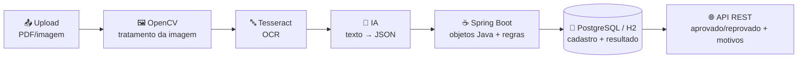

| # | Etapa | Classe | O que faz | Fallback |
| :---: | :--- | :--- | :--- | :--- |
| 1 | Documento | `ComprovanteController` | Recebe o texto e/ou a imagem/PDF em base64 | — |
| 2 | OpenCV | `OpenCvService` | PDF → imagem (300 dpi), escala de cinza, remoção de ruído, binarização e correção de inclinação | Imagem original |
| 3 | Tesseract | `OcrService` | Extrai o texto (`por`, saída TSV) e a confiança média das palavras | Texto de `conteudoDocumento` (confiança 95%) |
| 4 | IA | `InterpretadorIaService` | Texto → JSON do comprovante (OpenAI, `json_object`, `temperature 0`) | Interpretador local (regex) |
| 5 | Regras | `ValidacaoService` + `regras/*` | JSON → `ComprovanteResidencia` e aplicação das regras | — |
| 6 | Banco | `ValidacaoRepository` | Persiste dados extraídos, etapas e resultado | H2 em memória (padrão) |

> 💡 A resposta traz o campo `etapas`, dizendo o que aconteceu em cada passo — inclusive quando um fallback foi
> usado (ex.: `"OpenCV indisponível — imagem original"`). Assim a demo funciona sem credenciais nem ferramentas instaladas.

<h2 align="center" id="api">🌐 Endpoints </h2>

| Método | Rota | Descrição | Respostas |
| :---: | :--- | :--- | :--- |
| `GET` | `/api/clientes` | Lista os clientes cadastrados | `200` |
| `GET` | `/api/documentos/exemplo` | Payload pronto para a demo (data de emissão sempre recente) | `200` |
| `POST` | `/api/clientes/{clienteId}/comprovantes` | Envia o comprovante e executa o pipeline | `201` · `400` · `404` |
| `GET` | `/api/clientes/{clienteId}/comprovantes/{validacaoId}` | Consulta o resultado de uma validação | `200` · `404` |
| `GET` | `/api/validacoes` | Histórico de validações, da mais recente para a mais antiga | `200` |

O `POST` devolve `201` mesmo quando o comprovante é reprovado: o veredito fica em `resultado.status`. Erros voltam como
`{ "erro": "mensagem" }` — cliente ou validação inexistente (`404`), corpo sem texto nem imagem ou base64 inválido (`400`).

<details>
<summary>▶️📥 <b>Exemplo de request</b></summary>

```json
{
  "nomeArquivo": "comprovante-residencia.pdf",
  "mimeType": "application/pdf",
  "conteudoDocumento": "CONTA DE ENERGIA\nEmpresa: Neoenergia Pernambuco\nTitular: Joao da Silva\nEndereco: Rua das Flores, 150\nBairro: Boa Vista\nCidade: Recife - PE\nCEP: 50050-000\nData de emissao: 28/09/2026",
  "imagemBase64": null
}
```

| Campo | Obrigatório | Descrição |
| :--- | :---: | :--- |
| `nomeArquivo` | não | Nome exibido no resultado (padrão: `comprovante`) |
| `mimeType` | não | `image/png`, `image/jpeg` ou `application/pdf` |
| `conteudoDocumento` | um dos dois | Texto já extraído; também é o fallback se o OCR falhar |
| `imagemBase64` | um dos dois | Imagem ou PDF em base64 (aceita o prefixo `data:image/png;base64,`) |

O interpretador local reconhece linhas `Rótulo: valor`: `Titular`/`Nome`/`Cliente`, `Endereço`, `Bairro`, `Cidade`,
`CEP`, `Empresa`/`Distribuidora` e `Data de emissão` (`dd/mm/aaaa`).

</details>

<details>
<summary>▶️📤 <b>Exemplo de retorno — aprovado (<code>201 Created</code>)</b></summary>

```json
{
  "validacaoId": 1,
  "clienteId": 1,
  "nomeCliente": "Joao da Silva",
  "nomeArquivo": "comprovante-residencia.pdf",
  "criadoEm": "2026-10-08T13:56:48.703274",
  "etapas": [
    { "ordem": 1, "nome": "Documento", "resultado": "comprovante-residencia.pdf" },
    { "ordem": 2, "nome": "OpenCV", "resultado": "Imagem tratada (cinza, ruído, binarização, inclinação)" },
    { "ordem": 3, "nome": "Tesseract", "resultado": "Texto extraído (confiança 96%)" },
    { "ordem": 4, "nome": "IA", "resultado": "JSON estruturado gerado (interpretador local — regex)" },
    { "ordem": 5, "nome": "Regras", "resultado": "5 de 5 regras atendidas" }
  ],
  "dadosExtraidos": {
    "nomeTitular": "Joao da Silva",
    "endereco": "Rua das Flores, 150",
    "bairro": "Boa Vista",
    "cidadeUf": "Recife - PE",
    "cep": "50050-000",
    "empresaEmissora": "Neoenergia Pernambuco",
    "dataEmissao": "2026-09-28"
  },
  "resultado": {
    "status": "APROVADO",
    "regrasAtendidas": [
      "Documento legível",
      "Campos obrigatórios presentes",
      "Emissão dentro de 90 dias",
      "CEP válido",
      "Titular igual ao cliente cadastrado"
    ],
    "motivos": []
  }
}
```

Em caso de reprovação ou análise manual, `motivos` explica o que fazer — ex.: `"Comprovante emitido há mais de 90 dias
(120 dias). Envie um comprovante mais recente."` ou `"Comprovante em nome de \"Carlos Pereira Lima\", diferente do
cliente \"Joao da Silva\". Encaminhado para análise manual."`

</details>

<h2 align="center" id="executar">▶️ Como Executar </h2>

| Ferramenta | Obrigatória? | Para quê |
| :--- | :---: | :--- |
| JDK 21+ e Maven 3.9+ | ✅ | Backend |
| Node.js 18+ e npm | ✅ | Frontend |
| Tesseract + `tesseract-lang` | opcional | OCR de imagens de verdade |
| Python 3 + `scripts/requirements.txt` | opcional | Pré-processamento OpenCV e suporte a PDF |
| Docker | opcional | PostgreSQL |
| `OPENAI_API_KEY` | opcional | Extração com IA (sem a chave, usa regex) |

```bash
git clone https://github.com/wqiluc/Documentos-ocr-ia-java.git
cd Documentos-ocr-ia-java

# backend (http://localhost:8080)
cd Documentos-Ocr-IA-Java/backend && mvn spring-boot:run

# frontend, em outro terminal (http://localhost:5173)
cd Documentos-Ocr-IA-Java/frontend && npm install && npm run dev

# testes do backend
cd Documentos-Ocr-IA-Java/backend && mvn test
```

O Vite repassa `/api` para `http://localhost:8080`, então não há problema de CORS. Para apontar para outra API, crie
`frontend/.env` com `VITE_API_URL=<url>`.

<details>
<summary>▶️🧪 <b>O que os testes cobrem</b></summary>

| Classe de teste | O que cobre |
| :--- | :--- |
| `RegraEmissao90DiasTest` | Comprovante recente, exatamente 90 dias, mais de 90, data no futuro e sem data (`Clock` fixo) |
| `RegraCepValidoTest` | CEPs válidos (com/sem hífen) e inválidos (curto, longo, letras, `00000-000`) |
| `RegraTitularIgualClienteTest` | Nome igual ignorando acento/caixa/espaços e nome diferente → `ANALISE_MANUAL` |
| `ValidacaoServiceTest` | Pipeline completo com H2: aprovado, reprovado, análise manual, prioridade do reprovado e cliente inexistente |

</details>

<h3 align="left">⚙️ Integrações (opcionais)</h3>

Toda a configuração fica em `backend/src/main/resources/application.properties`. Sem nenhuma delas, a API usa os
fallbacks do [pipeline](#fluxo).

<details>
<summary>▶️🤖 <b>OpenAI</b></summary>

```bash
export OPENAI_API_KEY="sua-chave"
export OPENAI_MODEL="gpt-4o-mini"   # opcional
```

Propriedades: `app.ai.openai.api-key`, `app.ai.openai.model` e `app.ai.openai.url`. O campo `etapas[3].resultado`
mostra se foi usada a OpenAI ou o interpretador local.

</details>

<details>
<summary>▶️🔤 <b>Tesseract</b></summary>

```bash
brew install tesseract tesseract-lang   # macOS
tesseract --list-langs | grep por       # confere o português
```

Propriedades: `app.ocr.command=tesseract`, `app.ocr.tessdata-path=/opt/homebrew/share/tessdata` e `app.ocr.language=por`.
O `OcrService` roda `tesseract <arquivo> stdout -l por tsv`.

Instalação feita em 23/09 no macOS (Apple Silicon) — `tesseract 5.5.3` + `tesseract-lang 4.1.0`:

| 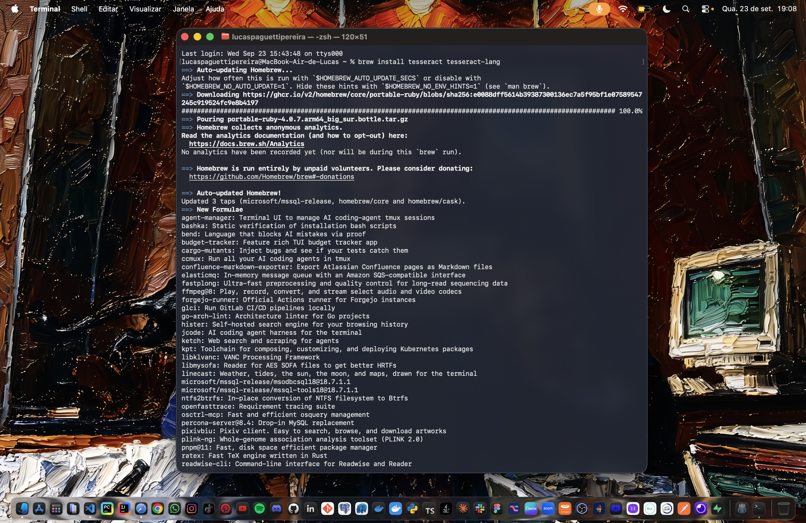 | 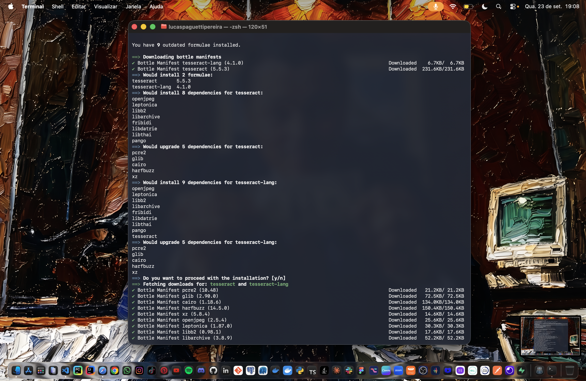 | 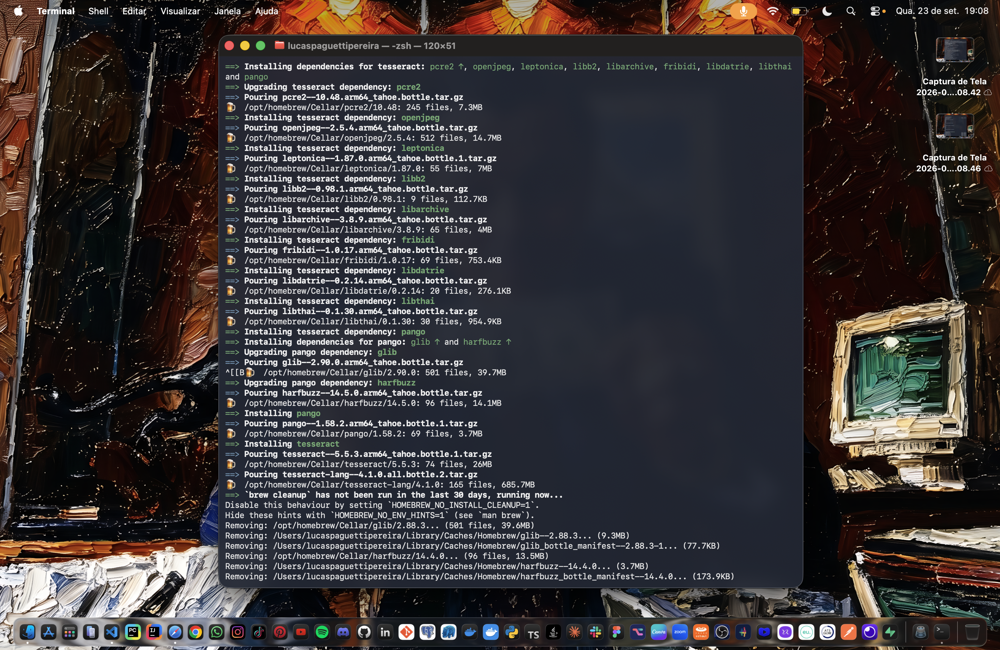 |
| :---: | :---: | :---: |
| 1️⃣ Comando de instalação | 2️⃣ Resolução de dependências | 3️⃣ Instalação concluída |

</details>

<details>
<summary>▶️🖼️ <b>OpenCV</b></summary>

```bash
cd Documentos-Ocr-IA-Java/backend
pip3 install -r scripts/requirements.txt

# testando o script sozinho
python3 scripts/pre-processar_documento.py conta-luz.pdf tratada.png
tesseract tratada.png stdout -l por

# documentação do script
python3 scripts/docs_pre-processar_documento.py
```

Propriedade: `app.opencv.command=python3 scripts/pre-processar_documento.py` (recebe `arquivoEntrada arquivoSaida.png`).
O caminho é relativo a `backend/`, então suba a API de dentro dela.

> ⚠️ O Tesseract não lê PDF. Sem o script, um PDF só é validado se o texto também vier em `conteudoDocumento`.

</details>

<details>
<summary>▶️🐘 <b>Banco de dados — H2 (padrão) ou PostgreSQL</b></summary>

O H2 em memória (modo PostgreSQL) não precisa de instalação, mas os dados somem quando a API para. Para o PostgreSQL:

```bash
cd Documentos-Ocr-IA-Java/backend
docker compose up -d                                       # PostgreSQL 16 na porta 5432
mvn spring-boot:run -Dspring-boot.run.profiles=postgres    # usuário/senha: DB_USER / DB_PASSWORD (padrão postgres)
```

Nos dois casos, o **Flyway** cria as tabelas `cliente` e `validacao_comprovante` e insere os clientes de exemplo; o
Hibernate fica em `ddl-auto=validate`.

| id | Nome | CPF |
| :---: | :--- | :--- |
| 1 | Joao da Silva | 529.982.247-25 |
| 2 | Maria Oliveira Santos | 111.444.777-35 |
| 3 | Ana Beatriz Cavalcanti | 407.324.134-60 |
| 4 | Pedro Henrique Albuquerque | 361.970.653-04 |
| 5 | Fernanda Lima Rocha | 347.031.846-80 |
| 6 | Rafael Souza Barbosa | 777.005.171-18 |
| 7 | Juliana Freitas Monteiro | 598.915.250-74 |

</details>

<h2 align="center" id="telas">🖥️ Telas do Frontend <br>


</h2>

Fluxo completo com o cliente **Joao da Silva** e o arquivo [`pdf/conta-luz-exemplo.png`](pdf/conta-luz-exemplo.png).

| 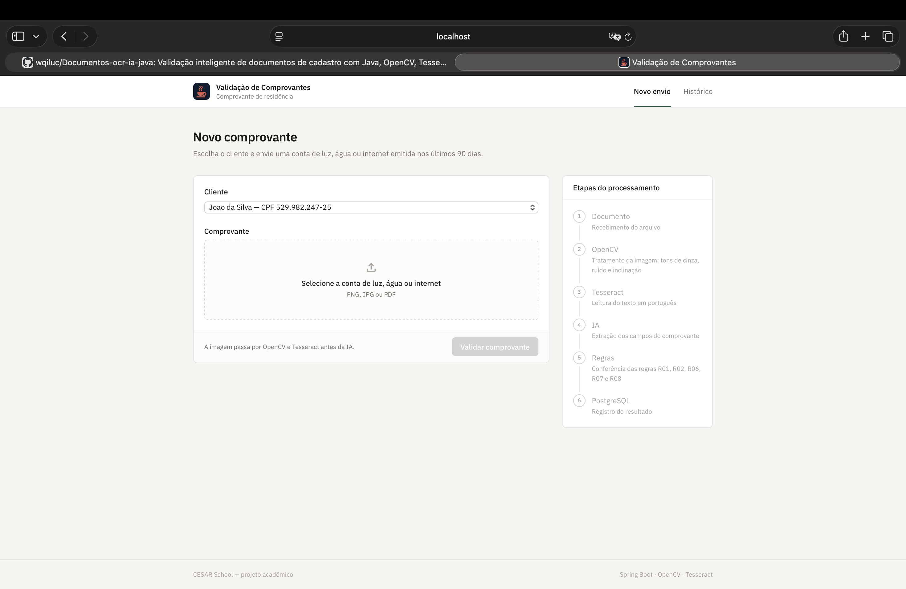 | 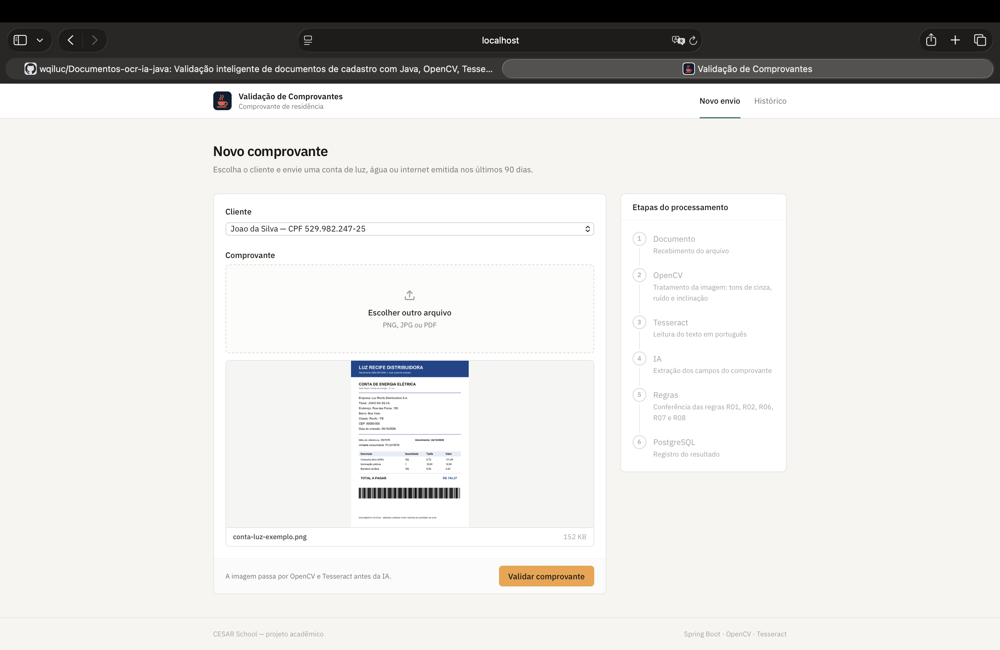 |
| :---: | :---: |
| 1️⃣ Novo envio (`/`) — escolha do cliente e do comprovante | 2️⃣ Arquivo selecionado, com a prévia antes de validar |

| 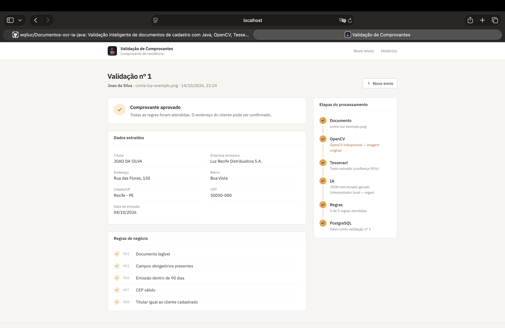 |
| :---: |
| 3️⃣ Resultado (`/resultado/:clienteId/:validacaoId`) — dados extraídos, regras R01–R08 e timeline das 6 etapas |

| 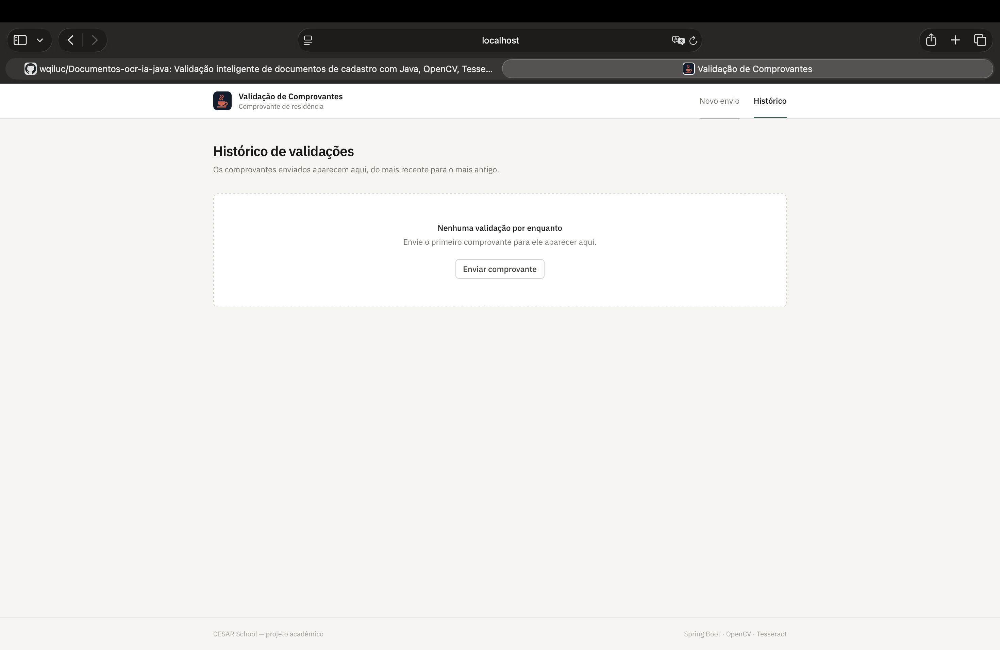 | 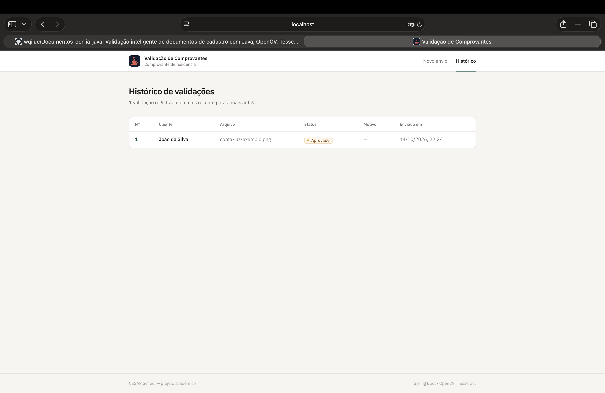 |
| :---: | :---: |
| 4️⃣ Histórico (`/validacoes`) ainda vazio | 5️⃣ Histórico com a validação aprovada |

> ℹ️ As capturas foram feitas sem o script OpenCV configurado, por isso a etapa 2 mostra o fallback
> "OpenCV indisponível — imagem original".

<h2 align="center" id="postman">🧰 Testando no Postman / Insomnia <br>


</h2>

Com o backend rodando, importe [`postman/Documentos-OCR-IA.postman_collection.json`](postman/Documentos-OCR-IA.postman_collection.json)
(Postman: `Import` · Insomnia: `Create` → `Import`). A coleção traz os 7 requests, as variáveis `baseUrl`, `clienteId`
e `validacaoId` (atualizada sozinha após o request "APROVADO") e um script que gera `{{dataRecente}}` (hoje − 10 dias).

> ⚠️ Use o **Postman Desktop** — o Web só acessa `localhost` com o *Postman Agent*. O [`docs/openapi.yaml`](docs/openapi.yaml)
> também pode ser importado (ou aberto no [Swagger Editor](https://editor.swagger.io)), mas seus exemplos têm a data
> fixa `28/09/2026`: ajuste para os últimos 90 dias, senão o cenário aprovado cai na R06.

| # | Request | Rota | Resultado esperado |
| :---: | :--- | :--- | :--- |
| 1 | Listar clientes | `GET /api/clientes` | `200` com os 7 clientes |
| 2 | Payload de exemplo | `GET /api/documentos/exemplo` | `200` com um corpo pronto para o POST |
| 3 | Comprovante — APROVADO | `POST /api/clientes/1/comprovantes` | `201` · `APROVADO` · 5 de 5 regras |
| 4 | Comprovante antigo — REPROVADO | `POST /api/clientes/1/comprovantes` | `201` · `REPROVADO` · "mais de 90 dias" |
| 5 | Comprovante de outra pessoa | `POST /api/clientes/1/comprovantes` | `201` · `ANALISE_MANUAL` |
| 6 | Consultar validação | `GET /api/clientes/1/comprovantes/{{validacaoId}}` | `200` com a validação do passo 3 |
| 7 | Histórico (backoffice) | `GET /api/validacoes` | `200` com todas as validações |

Outros cenários, editando o corpo:

| Altere… | Resultado |
| :--- | :--- |
| `CEP: 5005-00` | `REPROVADO` · CEP inválido (R07) |
| Remova a linha `Data de emissao` | `REPROVADO` · campo obrigatório ausente (R02) |
| Data de emissão no futuro | `REPROVADO` · data no futuro (R06) |
| Texto com menos de 40 caracteres | `REPROVADO` · documento ilegível (R01) |
| `Titular: JOÃO  DA SILVA` | `APROVADO` — acento, caixa e espaços extras são ignorados (R08) |
| URL `/api/clientes/999/comprovantes` | `404` · "Cliente 999 não encontrado." |
| Corpo `{}` | `400` · "Envie conteudoDocumento (texto) e/ou imagemBase64." |

Para testar o OCR com um arquivo de verdade, envie-o em `imagemBase64` (`base64 -i conta-luz.png | tr -d '\n' | pbcopy`
no macOS) com o `mimeType` correspondente — ou simplesmente escolha o arquivo no frontend. Com o H2, os dados e os ids
recomeçam a cada reinício da API.

<details>
<summary>▶️💻 <b>Os mesmos testes com curl</b></summary>

```bash
curl http://localhost:8080/api/clientes

# usa o payload de exemplo direto no POST
curl -s http://localhost:8080/api/documentos/exemplo \
  | curl -s -X POST http://localhost:8080/api/clientes/1/comprovantes \
         -H 'Content-Type: application/json' -d @-

curl http://localhost:8080/api/clientes/1/comprovantes/1
curl http://localhost:8080/api/validacoes
```

</details>

<details>
<summary>▶️🎬 <b>Roteiro para a demo</b></summary>

1. Suba o backend e o frontend **sem** chave OpenAI nem script OpenCV, para mostrar os fallbacks em `etapas`.
2. Use os botões de exemplo do frontend: conta recente → `APROVADO`; emitida há 120 dias ou CEP inválido →
   `REPROVADO` com o motivo; titular diferente → `ANALISE_MANUAL`.
3. Configure OpenAI, Tesseract e OpenCV e envie a foto de uma conta, mostrando a timeline passando pelas 6 etapas.
4. Abra o **Backoffice** (`/validacoes`) para mostrar o histórico de compliance.

</details>

<h2 align="center" id="rotas">🗺️ Rotas da API no Postman e no Insomnia <br>


</h2>

| 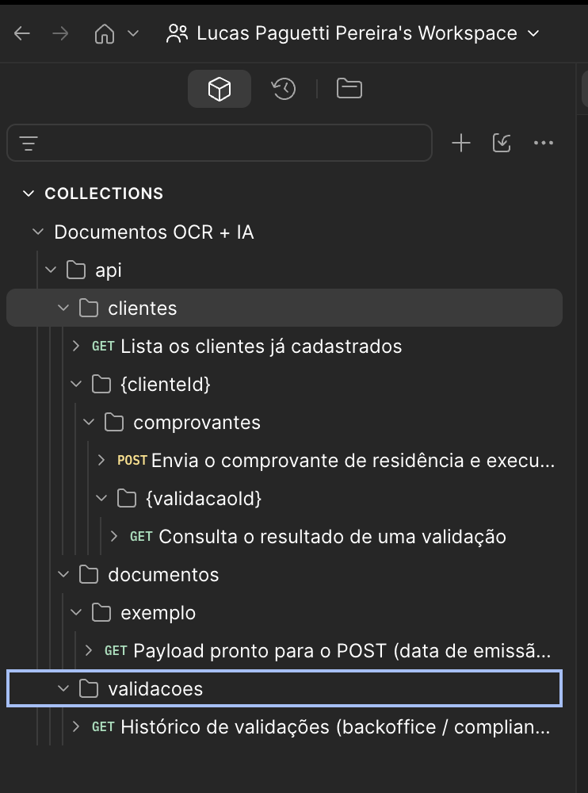 | 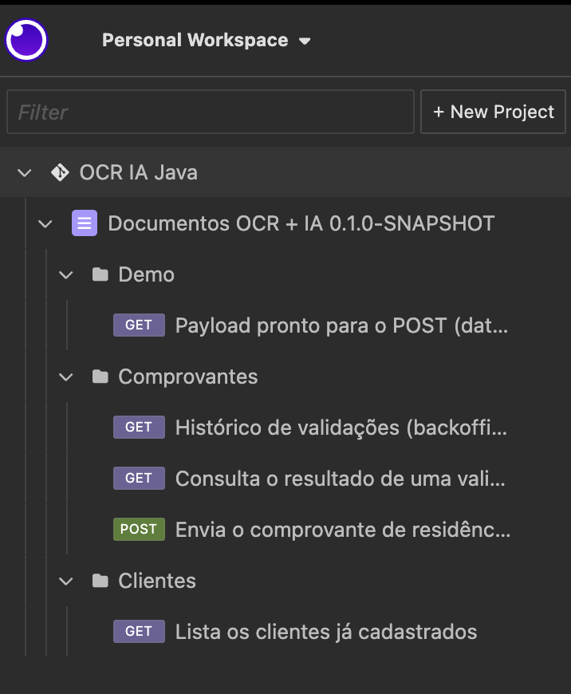 |
| :---: | :---: |
|  |  |

<h2 align="center" id="arquitetura">🏰 Arquitetura do Projeto <br>

</h2>

<pre>
Documentos-ocr-ia-java📄🔍/
├── Documentos-Ocr-IA-Java /
│   ├── backend   /
│   │   ├── pom.xml 
│   │   ├── docker-compose.yml 
│   │   ├── scripts /
│   │   │   ├── pre-processar_documento.py  
│   │   │   ├── docs_pre-processar_documento.py 
│   │   │   ├── cores.py 
│   │   │   └── requirements.txt 
│   │   └── src /
│   │       ├── main /
│   │       │   ├── resources /
│   │       │   │   ├── application.properties 
│   │       │   │   ├── application-postgres.properties 
│   │       │   │   └── db/migration /
│   │       │   │       └── V1__criar_tabelas.sql 
│   │       │   └── java/br/com/cesarschool/documentos /
│   │       │       ├── ValidacaoDocumentosApplication.java 
│   │       │       ├── config /
│   │       │       │   ├── AppProperties.java 
│   │       │       │   └── CorsConfig.java 
│   │       │       ├── controller /
│   │       │       │   ├── ComprovanteController.java 
│   │       │       │   └── DocumentoExemploController.java 
│   │       │       ├── dto /
│   │       │       │   ├── ValidacaoRequest.java 
│   │       │       │   ├── ValidacaoResponse.java 
│   │       │       │   ├── EtapaPipeline.java 
│   │       │       │   └── DadosComprovanteDto.java 
│   │       │       ├── service /
│   │       │       │   ├── ValidacaoService.java 
│   │       │       │   ├── OpenCvService.java 
│   │       │       │   ├── OcrService.java 
│   │       │       │   ├── InterpretadorIaService.java 
│   │       │       │   └── ComandoExterno.java 
│   │       │       ├── regras /
│   │       │       │   ├── Regra.java 
│   │       │       │   ├── ResultadoRegra.java 
│   │       │       │   ├── RegraLegibilidade.java  
│   │       │       │   ├── RegraCamposObrigatorios.java 
│   │       │       │   ├── RegraEmissao90Dias.java  
│   │       │       │   ├── RegraCepValido.java 
│   │       │       │   └── RegraTitularIgualCliente.java  
│   │       │       ├── dominio /
│   │       │       │   ├── Cliente.java 
│   │       │       │   ├── ResultadoValidacao.java 
│   │       │       │   ├── ComprovanteResidencia.java 
│   │       │       │   └── StatusValidacao.java  
│   │       │       ├── repository /
│   │       │       │   ├── ClienteRepository.java 
│   │       │       │   └── ValidacaoRepository.java 
│   │       │       └── exception /
│   │       │           ├── ClienteNaoEncontradoException.java 
│   │       │           └── GlobalExceptionHandler.java 
│   │       └── test/java/br/com/cesarschool/documentos /
│   │           ├── regras /
│   │           │   ├── RegraEmissao90DiasTest.java 
│   │           │   ├── RegraCepValidoTest.java 
│   │           │   └── RegraTitularIgualClienteTest.java 
│   │           └── service /
│   │               └── ValidacaoServiceTest.java 
│   │
│   └── frontend    /
│       ├── index.html 
│       ├── package.json 
│       ├── package-lock.json 
│       ├── vite.config.ts 
│       ├── tailwind.config.ts 
│       ├── postcss.config.js 
│       ├── tsconfig.json 
│       └── src /
│           ├── main.tsx 
│           ├── App.tsx 
│           ├── index.css 
│           ├── vite-env.d.ts 
│           ├── routes /
│           │   └── index.tsx 
│           ├── services /
│           │   └── api.ts 
│           ├── types /
│           │   └── validacao.ts 
│           ├── utils /
│           │   └── formatacao.ts 
│           ├── components /
│           │   ├── layout /
│           │   │   ├── LayoutPrincipal.tsx 
│           │   │   ├── Cabecalho.tsx 
│           │   │   └── TituloPagina.tsx 
│           │   ├── upload /
│           │   │   ├── FormularioUpload.tsx 
│           │   │   └── PreviewDocumento.tsx 
│           │   ├── resultado /
│           │   │   ├── LinhaEtapas.tsx 
│           │   │   ├── CartaoResultado.tsx 
│           │   │   ├── DadosExtraidos.tsx 
│           │   │   └── ListaRegras.tsx 
│           │   └── ui /
│           │       ├── SeloStatus.tsx 
│           │       ├── Carregando.tsx 
│           │       ├── MensagemErro.tsx 
│           │       ├── Painel.tsx 
│           │       ├── Icones.tsx 
│           │       └── classes.ts 
│           └── pages /
│               ├── Upload/PaginaUpload.tsx  
│               ├── Resultado/PaginaResultado.tsx  
│               └── Validacoes/PaginaValidacoes.tsx  
│
├── docs /
│   └── openapi.yaml 
│
├── postman /
│   └── Documentos-OCR-IA.postman_collection.json 
│
├── pdf /
│   ├── respostas_validacao_documentos_Paguetti.pdf 
│   ├── conta-luz-exemplo.png 
│   └── tela-*.png 
│
├── img /
│
├── .gitignore 
├── LICENSE 
└── README.md 
</pre>
