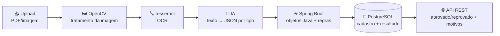

<h1 align="center"> Documentos OCR + IA 📄🔍🤖🏦<br>


[](https://github.com/wqiluc/Documentos-ocr-ia-java/blob/main/LICENSE)


</h1>

<p align="center">
Validação inteligente de documentos no <b>cadastro de novos clientes (onboarding) de um banco digital</b> —
o cliente envia o documento de identificação (RG/CNH) e o comprovante de residência, e o sistema faz
<b>OpenCV → Tesseract (OCR) → IA → regras em Java</b> para aprovar ou reprovar o cadastro, sempre
informando o motivo.
</p>

> ⚠️ **Status:** a estrutura de pastas do **backend** e do **frontend** já está criada em `Documentos-Ocr-IA-Java/`, mas os arquivos
> ainda estão **vazios**. As funcionalidades descritas abaixo ainda não estão implementadas — o README serve
> como especificação do projeto e do MVP. O Tesseract já foi instalado localmente (ver [prints](#tesseract-instalacao)).

<h2 align="center" id="autor">👤👨‍🎓 Autor: </h2>
<ul>
<li><b>Lucas Paguetti Pereira</b> — ADS · 3º período · CESAR School <a href="https://www.linkedin.com/in/lucas-paguetti-pereira" target="_blank"></a> <a href="https://github.com/wqiluc" target="_blank"></a></li>
</ul>

<h2 align="center" id="tecnologias"> ⛏️💻 Tecnologias Utilizadas: <br>

</h2>
<p align="center">
   <br>
  
  
  
   <br>
  
  
  
   <br>
  
   <br>
  
  
  
   <br>
  
  
  
</p>

<h2 align="center" id="problema">🧩 Problema <br>

</h2>

<p align="center">
No cadastro de novos clientes, a equipe de backoffice confere manualmente o documento de identificação e o
comprovante de residência: lê os dados, <b>redigita no sistema</b> e verifica se nome, CPF e endereço batem.
</p>

| Dor | Consequência |
| :--- | :--- |
| 🐢 Processo lento | O cliente espera dias pela abertura da conta |
| ⌨️ Redigitação manual | Erros de digitação de CPF e CEP |
| 🕵️ Conferência visual | Vulnerável a fraudes: documentos vencidos, comprovantes antigos ou em nome de outra pessoa |

<h2 align="center" id="usuarios">👥 Usuários </h2>

| Tipo | Quem | O que faz no sistema |
| :--- | :--- | :--- |
| ⭐ Principal | Analista de cadastro do backoffice | Acompanha os cadastros validados e trata os casos encaminhados para análise manual |
| 🛡️ Secundário | Equipe de compliance | Consulta o histórico e os motivos de reprovação |
| 📱 Secundário | Cliente | Envia os documentos pelo app e acompanha o status do cadastro |

<h2 align="center" id="documentos">📑 Documentos e Dados Extraídos </h2>

| Documento | Exemplos | Dados extraídos |
| :--- | :--- | :--- |
| 🪪 Identificação | RG ou CNH | Nome completo, CPF, data de nascimento, número do documento, órgão emissor/UF e data de validade (CNH) |
| 🏠 Comprovante de residência | Conta de luz, água ou internet | Nome do titular, endereço (logradouro e número), bairro, cidade/UF, CEP, empresa emissora e data de emissão |

<h2 align="center" id="regras">📏 Regras de Negócio </h2>

| # | Regra | Documento | No MVP? |
| :---: | :--- | :--- | :---: |
| R01 | Documento legível (OCR retornou texto suficiente e com boa confiança) | Ambos | 🚀 |
| R02 | Campos obrigatórios presentes (nome, CPF, datas e endereço) | Ambos | 🚀 |
| R03 | CPF com formato e dígitos verificadores válidos | Identificação | 🚀 |
| R04 | CNH dentro da data de validade | Identificação | 🚀 |
| R05 | Cliente maior de 18 anos, pela data de nascimento | Identificação | 🚀 |
| R06 | Comprovante emitido há no máximo 90 dias | Comprovante | 🚀 |
| R07 | CEP com formato válido (8 dígitos) | Comprovante | 🚀 |
| R08 | Nome do titular do comprovante igual ao nome do cliente | Cruzada | 🚀 |
| R09 | CPF não cadastrado anteriormente (cliente não duplicado) | Identificação | 🚀 |

<h3 align="left">✅ Aprovação</h3>

O cadastro é **aprovado** quando os dois documentos foram enviados, os campos obrigatórios foram extraídos,
o CPF é válido, a CNH está na validade, o cliente é maior de idade, o comprovante é recente e está no nome
do cliente — ou seja, **todas as regras foram atendidas**. Os dados validados são registrados para a
abertura da conta.

<h3 align="left">❌ Rejeição</h3>

O cadastro é **reprovado** quando ocorre qualquer um destes casos:

| Motivo | Regra | Resultado |
| :--- | :---: | :--- |
| Documento ilegível (imagem borrada, escura ou cortada) | R01 | `REPROVADO` |
| Campo obrigatório ausente (ex.: sem CPF ou sem data de emissão) | R02 | `REPROVADO` |
| CPF inválido ou já cadastrado | R03 · R09 | `REPROVADO` |
| CNH vencida ou cliente menor de 18 anos | R04 · R05 | `REPROVADO` |
| Comprovante com mais de 90 dias ou CEP inválido | R06 · R07 | `REPROVADO` |
| Comprovante em nome de outra pessoa (pode ser de um familiar) | R08 | `ANALISE_MANUAL` |

> A resposta **sempre informa o motivo**, para o cliente saber qual documento reenviar.

<h2 align="center" id="fluxo">🔄 Fluxo do Sistema </h2>



| Etapa | Responsável | O que faz |
| :---: | :--- | :--- |
| 1 | Upload | Cliente envia o documento (PDF ou imagem) |
| 2 | OpenCV | Pré-processa a imagem (escala de cinza, contraste, binarização, correção de inclinação) |
| 3 | Tesseract | Extrai o texto do documento (idioma `por`) |
| 4 | IA (OpenAI) | Interpreta o texto e devolve um JSON estruturado de acordo com o tipo de documento |
| 5 | Spring Boot | Converte o JSON em objetos Java e aplica as regras de negócio e a validação cruzada |
| 6 | PostgreSQL | Persiste o cadastro, os dados extraídos e o resultado da validação |
| 7 | API REST | Expõe o resultado: aprovado/reprovado + motivos |

<h2 align="center" id="mvp">🎯 MVP <br>

</h2>

<p align="center">
O MVP processa <b>apenas o comprovante de residência de um cliente já cadastrado</b>. O documento de
identificação (RG/CNH) e a validação cruzada completa ficam como evolução depois da demo.
</p>

| Item do MVP | Descrição | Status |
| :--- | :--- | :---: |
| 📤 Upload | Endpoint de upload do comprovante vinculado ao cliente | ⏳ |
| 🔤 OCR + IA | Pré-processamento, OCR e extração estruturada via IA | ⏳ |
| 📏 Regras básicas | Legibilidade, campos obrigatórios, emissão ≤ 90 dias, CEP válido e nome do titular igual ao do cliente | ⏳ |
| 💾 Persistência | Resultado salvo no PostgreSQL | ⏳ |
| 🌐 Consulta | Resultado consultável via endpoint REST | ⏳ |

<h2 align="center" id="api">🌐 Endpoints Planejados </h2>

| Método | Rota | Descrição |
| :---: | :--- | :--- |
| `GET` | `/api/documentos/exemplo` | Retorna um payload pronto para demonstração |
| `POST` | `/api/clientes/{clienteId}/comprovantes` | Envia o comprovante de residência do cliente e executa o pipeline |
| `GET` | `/api/clientes/{clienteId}/comprovantes/{validacaoId}` | Consulta o resultado de uma validação |

<details>
<summary>▶️📥 <b>Exemplo de request</b></summary>

```json
{
  "nomeArquivo": "comprovante-residencia.pdf",
  "mimeType": "application/pdf",
  "conteudoDocumento": "CONTA DE ENERGIA\nTitular: Joao da Silva\nEndereco: Rua das Flores, 150\nBairro: Boa Vista\nCidade: Recife - PE\nCEP: 50050-000\nData de emissao: 10/08/2026",
  "imagemBase64": null
}
```

Você pode enviar apenas `conteudoDocumento` (texto já extraído), apenas `imagemBase64`, ou ambos.

</details>

<details>
<summary>▶️📤 <b>Exemplo de retorno — aprovado</b></summary>

```json
{
  "validacaoId": 1,
  "clienteId": 42,
  "nomeArquivo": "comprovante-residencia.pdf",
  "etapas": [
    { "ordem": 1, "nome": "Documento", "resultado": "comprovante-residencia.pdf" },
    { "ordem": 2, "nome": "OpenCV", "resultado": "Imagem tratada" },
    { "ordem": 3, "nome": "Tesseract", "resultado": "Texto extraído (confiança 91%)" },
    { "ordem": 4, "nome": "IA", "resultado": "JSON estruturado gerado" },
    { "ordem": 5, "nome": "Regras", "resultado": "5 de 5 regras atendidas" }
  ],
  "dadosExtraidos": {
    "nomeTitular": "Joao da Silva",
    "endereco": "Rua das Flores, 150",
    "bairro": "Boa Vista",
    "cidadeUf": "Recife - PE",
    "cep": "50050-000",
    "empresaEmissora": "Neoenergia Pernambuco",
    "dataEmissao": "2026-08-10"
  },
  "resultado": {
    "status": "APROVADO",
    "regrasAtendidas": [
      "Documento legível",
      "Campos obrigatórios presentes",
      "Emissão dentro de 90 dias",
      "CEP válido",
      "Titular igual ao cliente cadastrado"
    ],
    "motivos": []
  }
}
```

</details>

<details>
<summary>▶️⚠️ <b>Exemplo de retorno — reprovado</b></summary>

```json
{
  "resultado": {
    "status": "REPROVADO",
    "regrasAtendidas": [
      "Documento legível",
      "Campos obrigatórios presentes",
      "CEP válido",
      "Titular igual ao cliente cadastrado"
    ],
    "motivos": [
      "Comprovante emitido há mais de 90 dias. Envie um comprovante mais recente."
    ]
  }
}
```

</details>

<h2 align="center" id="integracoes">🔌 Integrações e Configuração </h2>

<p align="center">
A ideia é ter integração real com OpenAI, Tesseract e OpenCV, mas com <b>fallback local</b> para a demo
funcionar mesmo sem credenciais ou ferramentas instaladas.
</p>

<details>
<summary>▶️🤖 <b>OpenAI</b></summary>

Defina a chave antes de subir a aplicação:

```bash
export OPENAI_API_KEY="sua-chave"
```

Em `application.properties`:

```properties
app.ai.openai.api-key=${OPENAI_API_KEY:}
```

Com a chave configurada, o `InterpretadorIaService` chama a API da OpenAI e pede um JSON estruturado.
Sem a chave, usa um interpretador local baseado em expressões regulares.

</details>

<details>
<summary>▶️🔤 <b>Tesseract</b></summary>

```bash
brew install tesseract tesseract-lang   # macOS
```

```properties
app.ocr.command=tesseract
app.ocr.tessdata-path=/opt/homebrew/share/tessdata
app.ocr.language=por
```

Se o Tesseract não estiver configurado, a aplicação usa o texto enviado em `conteudoDocumento` como fallback.

</details>

<h3 align="center" id="tesseract-instalacao">🔤 Instalação do Tesseract — 23/09 <br>


</h3>

<p align="center">
Instalação do Tesseract OCR no macOS (Apple Silicon) via Homebrew, com o pacote de idiomas
<code>tesseract-lang</code> — que inclui o português (<code>por</code>) usado no OCR dos comprovantes.
</p>

| Imagem | Etapa | Descrição |
| :---: | :--- | :--- |
|  | 1️⃣ Comando de instalação | `brew install tesseract tesseract-lang` — o Homebrew se atualiza antes de começar |
|  | 2️⃣ Resolução de dependências | Manifests de `tesseract 5.5.3` e `tesseract-lang 4.1.0`, com as dependências (`leptonica`, `openjpeg`, `pango`, …) a instalar/atualizar |
|  | 3️⃣ Instalação concluída | Dependências instaladas e `tesseract` + `tesseract-lang` copiados para `/opt/homebrew/Cellar` |

<details>
<summary>▶️🖼️ <b>OpenCV</b></summary>

Comando externo que recebe `arquivoEntrada arquivoSaida` e faz o pré-processamento real com OpenCV:

```properties
app.opencv.command=python3 scripts/preprocessar_documento.py
```

Quando `imagemBase64` for enviado, o `OpenCvService` chama esse comando, recebe a imagem tratada e a
encaminha para o Tesseract.

</details>

<details>
<summary>▶️🐘 <b>PostgreSQL</b></summary>

```properties
spring.datasource.url=jdbc:postgresql://localhost:5432/validacao_documentos
spring.datasource.username=${DB_USER:postgres}
spring.datasource.password=${DB_PASSWORD:postgres}
spring.jpa.hibernate.ddl-auto=update
```

</details>

<h2 align="center" id="executar">▶️ Como Executar </h2>

```bash
git clone https://github.com/wqiluc/Documentos-ocr-ia-java.git
cd Documentos-ocr-ia-java

# backend (API em http://localhost:8080)
cd Documentos-Ocr-IA-Java/backend && mvn spring-boot:run

# frontend (em outro terminal — http://localhost:5173)
cd Documentos-Ocr-IA-Java/frontend && npm install && npm run dev
```

<h3 align="left">🎬 Roteiro para a demo</h3>

1. Suba a API com `mvn spring-boot:run` (em `Documentos-Ocr-IA-Java/backend/`) e o frontend com `npm run dev` (em `Documentos-Ocr-IA-Java/frontend/`).
2. Use `GET /api/documentos/exemplo` para pegar um payload base.
3. Comece **sem** chave OpenAI nem Tesseract para mostrar o fallback local.
4. Envie um comprovante recente no nome do cliente → `APROVADO`.
5. Envie um comprovante antigo ou com CEP inválido → `REPROVADO` com o motivo.
6. Envie um comprovante em nome de outra pessoa → `ANALISE_MANUAL`.
7. Configure OpenAI, Tesseract e OpenCV para mostrar a versão mais próxima do mundo real.

<h2 align="center" id="arquitetura">🏰 Arquitetura do Projeto <br>

</h2>

<p align="center">
Estrutura já criada no repositório — <b>todos os arquivos estão vazios</b> e serão preenchidos durante a implementação do MVP.
</p>

<pre>
Documentos-ocr-ia-java &nbsp;/
├── img /
├── pdf /
│
└── Documentos-Ocr-IA-Java /
    ├── backend   /
    │   ├── pom.xml 
    │   ├── scripts/ 
    │   │   ├── preprocessar_documento.py 
    │   │   └── requirements.txt
    │   └── src/
    │       ├── main/java/br/com/cesarschool/documentos /
    │       │   ├── ValidacaoDocumentosApplication.java 
    │       │   ├── config /
    │       │   │   ├── AppProperties.java
    │       │   │   └── CorsConfig.java
    │       │   ├── controller /
    │       │   │   ├── ComprovanteController.java
    │       │   │   └── DocumentoExemploController.java
    │       │   ├── dto /
    │       │   │   ├── ValidacaoRequest.java
    │       │   │   ├── ValidacaoResponse.java
    │       │   │   ├── EtapaPipeline.java
    │       │   │   └── DadosComprovanteDto.java
    │       │   ├── service /
    │       │   │   ├── OpenCvService.java 
    │       │   │   ├── OcrService.java 
    │       │   │   ├── InterpretadorIaService.java 
    │       │   │   └── ValidacaoService.java 
    │       │   ├── regras /
    │       │   │   ├── Regra.java 
    │       │   │   ├── ResultadoRegra.java
    │       │   │   ├── RegraLegibilidade.java 
    │       │   │   ├── RegraCamposObrigatorios.java 
    │       │   │   ├── RegraEmissao90Dias.java 
    │       │   │   ├── RegraCepValido.java 
    │       │   │   └── RegraTitularIgualCliente.java 
    │       │   ├── dominio /
    │       │   │   ├── Cliente.java 
    │       │   │   ├── ComprovanteResidencia.java 
    │       │   │   ├── ResultadoValidacao.java 
    │       │   │   └── StatusValidacao.java 
    │       │   ├── repository /
    │       │   │   ├── ClienteRepository.java
    │       │   │   └── ValidacaoRepository.java
    │       │   └── exception /
    │       │       ├── ClienteNaoEncontradoException.java
    │       │       └── GlobalExceptionHandler.java
    │       ├── main/resources/
    │       │   ├── application.properties
    │       │   └── db/migration/V1__criar_tabelas.sql 
    │       └── test/java/br/com/cesarschool/documentos /
    │           ├── regras/
    │           │   ├── RegraEmissao90DiasTest.java
    │           │   ├── RegraCepValidoTest.java
    │           │   └── RegraTitularIgualClienteTest.java
    │           └── service/
    │               └── ValidacaoServiceTest.java
    │
    └── frontend    /
        ├── index.html 
        ├── package.json 
        ├── vite.config.ts 
        ├── tailwind.config.ts 
        ├── postcss.config.js 
        ├── tsconfig.json 
        ├── public/
        └── src /
            ├── main.tsx · App.tsx · index.css · vite-env.d.ts
            ├── routes/index.tsx 
            ├── services/api.ts 
            ├── types/validacao.ts 
            ├── components /
            │   ├── layout /
            │   │   ├── LayoutPrincipal.tsx 
            │   │   └── Cabecalho.tsx 
            │   ├── upload /
            │   │   ├── FormularioUpload.tsx 
            │   │   └── PreviewDocumento.tsx 
            │   ├── resultado /
            │   │   ├── CartaoResultado.tsx 
            │   │   ├── ListaRegras.tsx 
            │   │   └── LinhaEtapas.tsx 
            │   └── ui /
            │       ├── SeloStatus.tsx 
            │       └── Carregando.tsx 
            └── pages /
                ├── Upload/PaginaUpload.tsx 
                ├── Resultado/PaginaResultado.tsx 
                └── Validacoes/PaginaValidacoes.tsx 
</pre>